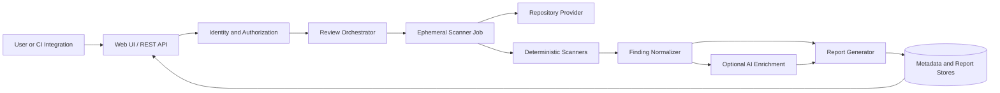

# 2. Solution Overview

## 2.1 Architectural Summary

AI Scan Repos is organized as a stateless control plane and an isolated analysis plane. The control plane accepts review requests, establishes identity and authorization, coordinates work, and exposes results. The analysis plane creates one ephemeral Kubernetes Job for each review and treats the selected repository revision as untrusted input.

The platform separates review management from repository analysis.

The Backend API is responsible for receiving review requests, authenticating users, verifying repository ownership, managing review jobs, and controlling access to reports.

Repository analysis is performed in a separate ephemeral Kubernetes pod, where the selected repository is cloned into a temporary workspace and analyzed using deterministic security scanners and optional AI enrichment.

This separation ensures that untrusted repository content is never processed inside the Backend API. Each scanner Job runs with limited permissions, restricted network access, temporary storage, and is automatically deleted when the review is complete.

## 2.2 Major Capabilities

| Capability | Architectural responsibility |
|---|---|
| Review submission | Validate repository, ref, requested report level, and request identity |
| Repository authorization | Verify access through the repository provider rather than Git metadata |
| Work orchestration | Create, monitor, cancel, time out, and reconcile scanner Jobs |
| Repository acquisition | Resolve an immutable commit and clone with a short-lived read-only credential |
| Deterministic analysis | Run approved scanners against the complete selected revision |
| Finding normalization | Convert tool-specific output into a versioned common model |
| AI enrichment | Explain and prioritize bounded deterministic findings under explicit policy |
| Reporting | Generate sanitized Summary Reports and authorized Deep Reports |
| Persistence | Store review metadata, findings, report objects, and append-only audit events |
| Operations | Provide health, metrics, logs, traces, alerts, quotas, and retention workflows |

## 2.3 Architectural Layers

### Experience Layer

The React web application and REST API support developers, security engineers, administrators, and automation clients. They expose stable workflows without revealing Kubernetes, storage, or provider implementation details.

### Control Layer

The backend contains authentication, authorization, review orchestration, provider adapters, report access control, and audit services. It owns the review state machine and all decisions that affect tenant access or scanner execution.

### Analysis Layer

The scanner container clones a single approved revision, invokes deterministic scanner plugins, normalizes results, builds limited context, optionally requests AI enrichment, and generates report artifacts. Each Job is stateless beyond its temporary workspace.

### Data Layer

PostgreSQL stores transactional metadata, normalized finding records, authorization evidence, and audit events. Encrypted object storage stores larger report artifacts. A queue or Redis may support scheduling and idempotency, but the database remains the authoritative review-state store.

### Platform Layer

Kubernetes provides scheduling and workload isolation. Helm packages application resources; Terraform provisions infrastructure dependencies. Observability services collect security-filtered telemetry.

## 2.4 Report Model

The platform supports two views derived from an authorized review result:

- **Summary Report:** contains aggregate scores, severity counts, scanner coverage, high-level categories, and non-sensitive guidance. It must not expose paths, lines, snippets, secret material, or other repository-specific evidence.
- **Deep Report:** contains file locations, evidence, contextual explanations, and remediation guidance. Access requires authenticated identity and live or recently validated repository authorization according to policy.

Generating the two views from one normalized result model reduces inconsistencies. Sanitization is an explicit transformation, not a frontend-only display rule.

## 2.5 Key Quality Attributes

The design prioritizes confidentiality and isolation over minimum scan latency. It favors replaceable adapters over vendor-specific convenience, full-scan coverage over purely incremental analysis, and durable auditability over implicit decisions. Availability goals are met by scaling stateless services and independent Jobs, while provider and scanner failures are represented explicitly as partial or terminal review outcomes.

## 2.6 Design Boundaries

The platform analyzes repositories but does not compile or execute repository-supplied code in the initial design. It provides remediation guidance but does not alter repositories. AI output is advisory, labeled, and traceable to deterministic inputs. Any future capability that changes these boundaries requires a threat-model update and an ADR.

Next: [System Context](03-system-context.md).
