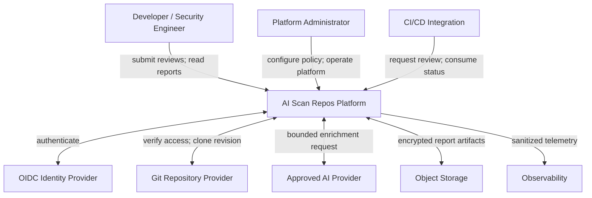

# 3. System Context

## 3.1 System Boundary

AI Scan Repos includes the web interface, backend control plane, scanner workload, reporting pipeline, platform-owned data stores, and operational telemetry. Identity providers, source-control platforms, AI providers, notification systems, and cloud-managed infrastructure are external dependencies even when deployed in the same organization.

## 3.2 Actors

| Actor | Responsibilities | Trust level |
|---|---|---|
| Anonymous user | Request or view policy-approved public summaries | Untrusted |
| Authenticated developer | Submit reviews and access authorized results | Authenticated, not implicitly repository-authorized |
| Verified organization member | Access Deep Reports for approved repositories | Authenticated and provider-authorized |
| Security engineer | Triage findings within assigned organizational scope | Privileged within assigned scope |
| Platform administrator | Configure providers, policy, quotas, retention, and operations | Highly privileged; audited |
| CI/CD integration | Submit automated reviews using a workload identity | Non-human identity with narrow scope |

Authentication does not imply repository authorization. The platform evaluates report access and review creation against both platform policy and repository-provider evidence.

## 3.3 External Systems

### Identity Provider

The identity provider authenticates human users and issues signed OIDC tokens. The platform validates token signature, issuer, audience, expiry, and required claims. Administrative and organizational roles are mapped through explicit configuration.

### Repository Providers

GitHub is the initial provider. GitLab, Azure DevOps, and Bitbucket are future adapters. Providers supply canonical repository identity, access verification, immutable revision resolution, and short-lived clone authorization. The platform does not accept a provider response without validating organization and repository scope.

### AI Providers

AI may be local, organization-hosted, or externally hosted. Each provider is accessed through a common interface and an outbound policy boundary. AI remains optional; deterministic scanning and reporting must complete when enrichment is disabled or unavailable.

### Data and Operations Services

PostgreSQL, encrypted object storage, secret management, metrics, logging, tracing, and alerting services may be managed externally. Their identities, encryption keys, retention, and network paths remain part of the platform security design.

## 3.4 Context-Level Data Exchanges

| Exchange | Data | Required protection |
|---|---|---|
| Browser to platform | Identity token, repository reference, report request | TLS, CSRF protection, input validation, rate limiting |
| Platform to identity provider | OIDC authorization and token validation data | TLS, state/nonce/PKCE, secret protection |
| Platform to repository provider | Canonical repository ID and authorization query | TLS, least-privilege application identity, audit |
| Scanner to repository provider | Immutable revision and short-lived clone credential | TLS, read-only scope, no credential logging |
| Platform to AI provider | Minimized finding context and policy metadata | TLS, approved region/provider, redaction, no-retention terms |
| Platform to report storage | Sanitized report object and metadata | Encryption, scoped workload identity, integrity controls |
| Platform to observability | Structured operational events | Redaction, access control, bounded cardinality and retention |

## 3.5 System Context Constraints

- External provider failure must not silently weaken authorization.
- Repository redirects, submodules, and large-file storage endpoints are subject to the same egress and credential policy as the primary clone.
- Unverified users cannot derive sensitive repository details from status codes, timings, summaries, logs, or identifiers.
- External identities are mapped to internal subjects; provider usernames are not durable primary keys.
- Every external dependency has explicit timeouts, retry limits, circuit-breaking behavior, and observable failure states.

Next: [Component Architecture](04-component-architecture.md).
