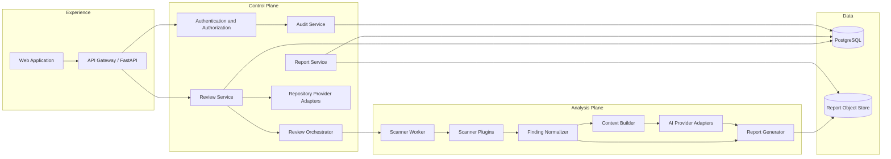

# 4. Component Architecture

## 4.1 Logical Components



## 4.2 Component Responsibilities

| Component | Responsibilities | Must not do |
|---|---|---|
| Web Application | Submit reviews, display status, render authorized reports | Enforce report security as the only control |
| API | Validate requests, expose versioned contracts, propagate identity and correlation context | Execute scanners or trust client-supplied ownership claims |
| Authentication Service | Validate identity tokens and establish internal subject | Decide repository access by itself |
| Authorization Service | Combine roles, tenant policy, report level, and provider evidence | Infer ownership from repository content |
| Review Service | Own review lifecycle, idempotency, state transitions, and user-visible status | Directly run untrusted tools |
| Repository Service | Canonicalize repositories, verify access, resolve refs, request clone credentials | Persist reusable repository credentials |
| Review Orchestrator | Create and reconcile bounded Kubernetes Jobs | Allow users to choose arbitrary image, command, or namespace |
| Report Service | Apply access policy and return Summary or Deep Report views | Return raw report objects without server-side authorization |
| Audit Service | Record append-only security and lifecycle events | Store source, secrets, or raw evidence unnecessarily |
| Scanner Worker | Coordinate clone, scanning, normalization, enrichment, upload, and cleanup | Expose a public service or retain source after completion |
| Scanner Plugins | Invoke approved deterministic tools and emit bounded results | Execute repository-defined build hooks |
| Finding Normalizer | Map scanner output to the versioned finding schema | Drop unsupported fields without recording compatibility errors |
| Context Builder | Select minimal evidence required for enrichment | Send whole repositories to AI providers by default |
| AI Provider Adapter | Apply provider protocol, timeout, schema, and policy controls | Make authorization decisions or override deterministic evidence |
| Report Generator | Produce consistent Summary and Deep representations | Embed detected secret values in output |

## 4.3 Review State Ownership

The Review Service is the sole authority for lifecycle state. The high-level state model is:

```text
requested -> authorizing -> queued -> running -> finalizing -> completed
                    |          |         |            |
                    +----------+---------+------------+-> failed
                               +-----------------------> cancelled
```

Transitions are persisted transactionally with an expected current version. Kubernetes Pod state is evidence used by reconciliation, not the source of truth exposed directly to clients. A completed review records scanner coverage, errors, report integrity metadata, and cleanup outcome.

## 4.4 Interface Principles

- Interfaces are versioned and exchange validated schemas.
- Provider adapters translate vendor concepts into canonical internal identities.
- Scanner adapters return results and execution metadata without leaking tool-specific control into orchestration.
- Long-running operations use asynchronous status rather than holding HTTP requests open.
- Commands use argument arrays and server-owned templates; user input never becomes a shell expression.
- Every remote interaction has an explicit timeout, bounded retry policy, and correlation identifier.
- Sensitive values are passed by secret reference or workload identity rather than embedded in messages.

## 4.5 Failure Isolation

A single scanner failure may produce a partial report only when policy permits and the report clearly identifies missing coverage. Authorization, repository resolution, clone, report integrity, or cleanup failures are never hidden. AI failure does not invalidate deterministic findings. Component-level circuit breakers prevent a provider outage from exhausting API or worker capacity.

Next: [Platform Deployment](05-platform-deployment.md).
