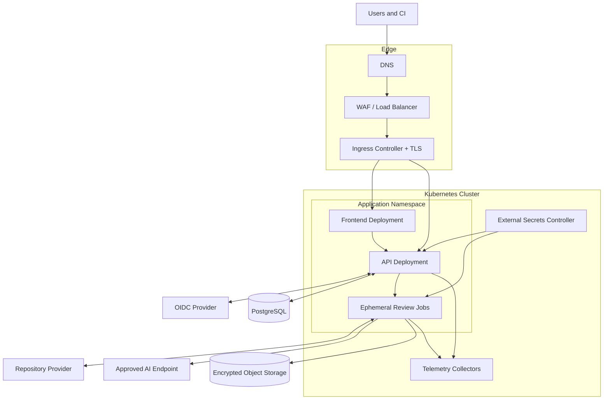

# 5. Platform Deployment

**Document Version:** 1.0

**Status note (updated 2026-09-24, see [Scope Decisions Log](../SCOPE-DECISIONS.md)):** Kubernetes is no longer future work: `review-api` runs on the team's k3s cluster, and manifests exist for the gateway, backend, Postgres and the reports volume. What this chapter still describes as target rather than built is the surrounding platform - WAF, autoscaling, a dedicated node pool and a managed database. Read the Kubernetes parts as current and the cloud-platform parts as intended.

## 5.1 Deployment Model

AI Scan Repos is deployed to Kubernetes. Long-running control-plane workloads run as Deployments, while each repository review runs as a short-lived Job. Managed PostgreSQL, object storage, secret management, and identity services are preferred where available but remain behind provider-independent interfaces.

## 5.2 Workload Placement

| Workload | Kubernetes primitive | Scaling model |
|---|---|---|
| Frontend | Deployment and Service | Horizontal replicas based on request load |
| Backend API | Deployment and Service | Horizontal replicas based on request latency and CPU |
| Review scanner | One Job per review | Queue depth, quotas, and cluster capacity |
| Reconciler | Deployment or API-owned controller loop | Leader-elected singleton or partitioned workers |
| Telemetry agents | DaemonSet/Deployment managed by platform | Based on cluster topology and ingestion load |

API and frontend replicas are spread across failure domains. Review Jobs may use a dedicated node pool with taints, quotas, autoscaling, and stronger runtime isolation. Data services must not share ephemeral scanner nodes.

## 5.3 Environment Strategy

Development, staging, and production use the same Helm chart with environment-specific values. Images are promoted by immutable digest rather than rebuilt per environment. Configuration is non-secret and version-controlled; secrets are referenced from an external secret manager.

Production changes follow progressive delivery or controlled rolling updates. Database changes use backward-compatible expand/migrate/contract steps. Helm releases use readiness checks, atomic rollback, and policy validation before admission.

## 5.4 Availability and Scaling

- Multiple API and frontend replicas remove single-Pod dependency.
- Pod disruption budgets and topology spread protect planned maintenance and zone failure.
- Review Jobs are independent; one failure cannot terminate another review.
- Per-tenant concurrency and global queue limits protect shared capacity.
- Cluster autoscaling adds scanner capacity within defined cost and security boundaries.
- Provider calls use timeouts and circuit breakers to prevent cascading failure.
- PostgreSQL and object storage use environment-appropriate redundancy, backup, and restoration testing.

The initial HLD does not define numeric SLOs. They must be established from representative load tests and business expectations before production approval.

## 5.5 Network Architecture

Ingress terminates TLS at an approved edge and forwards only documented HTTP routes. Network policies begin with default deny. The API receives ingress from the ingress controller and connects only to required identity, data, Kubernetes API, and telemetry endpoints. Scanner Jobs receive no inbound connections and may reach only DNS, the approved repository provider, approved vulnerability databases, report storage, telemetry, and the selected AI endpoint.

Production deployments should route scanner egress through an authenticated proxy or egress gateway so hostname policy, IP changes, volume controls, and audit records can be managed centrally.

## 5.6 Deployment Security

All containers run as non-root, drop Linux capabilities, prohibit privilege escalation, use a read-only root filesystem, and apply the runtime-default seccomp profile. Images are minimal, scanned, accompanied by an SBOM, signed, and admitted by digest. Service accounts are unique per component; scanner Jobs do not mount Kubernetes API credentials.

Temporary storage uses size-limited `emptyDir` volumes. Review Jobs have CPU, memory, process, time, and retry bounds. Kubernetes TTL cleanup is defense in depth and does not replace application-confirmed workspace cleanup.

## 5.7 Disaster Recovery

Repository source requires no backup because it is intentionally ephemeral. Recovery focuses on PostgreSQL metadata, audit events, report objects, configuration, encryption keys, and infrastructure definitions. Recovery procedures must define tested recovery point and recovery time objectives, key restoration, report integrity verification, and reconciliation of Jobs active during an outage.

Next: [Repository Analysis Flow](06-repository-analysis-flow.md).
