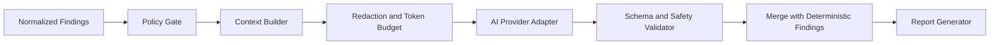

# 9. AI Analysis Engine

## 9.1 Purpose

The AI Analysis Engine enriches deterministic findings with contextual explanation, prioritization, root-cause hypotheses, and remediation guidance. It is not a scanner, policy authority, or source of repository ownership. The platform remains useful when AI is disabled.

## 9.2 Processing Pipeline

The Policy Gate evaluates tenant configuration, repository classification, report level, provider approval, geographic restrictions, and user consent where required. If the policy denies AI use, findings proceed directly to reporting.

## 9.3 Context Construction

The Context Builder begins with normalized findings rather than unrestricted repository content. It selects the minimum relevant context using path, line range, language, rule metadata, and a strict byte/token budget. It excludes binary files, generated content, dependency directories, detected secrets, credentials, personal data where identified, and files prohibited by tenant policy.

Whole-repository prompts are prohibited by default. Any future repository-level summarization must use an approved hierarchical process with the same classification and minimization controls.

**POC scope note (see [Scope Decisions Log](../SCOPE-DECISIONS.md)):** the initial implementation (`code-review-mcp`) sends full file content to the model rather than minimized per-finding context windows, because the Context Builder described above is not yet built and the existing reviewer already provides real value from reading whole files. This is an accepted, deliberate scope reduction for the course POC, not a silent gap, conditioned on two mandatory controls: (1) secret values are redacted from file content before it leaves the review workspace, and (2) repository content is explicitly delimited as untrusted data per §9.4. This exception ends the moment any non-local, hosted AI provider is enabled — full Context Builder minimization becomes mandatory before repository content leaves team-controlled local hardware.

## 9.4 Prompt-Injection Controls

Repository content is untrusted evidence and is delimited as data. Model instructions are server-owned, versioned, and not derived from repository files. The model is explicitly told not to follow instructions found in code, comments, documentation, filenames, scanner messages, or tool output.

The AI adapter exposes no autonomous repository, network, shell, storage, or deployment tools. Responses are constrained to a documented schema and validated for type, size, unsupported claims, secret reflection, and unsafe links before use.

## 9.5 Provider Abstraction

The common provider interface accepts a policy-approved request containing task type, model policy, normalized findings, minimized context, schema version, timeout, and correlation metadata. It returns structured enrichment plus provider/model identifiers, latency, token usage where available, and safety status.

Initial adapters may support Ollama, LM Studio, and an approved hosted provider. Future providers can include Azure OpenAI, AWS Bedrock, or vLLM. Business logic selects an AI policy profile, not a vendor-specific model name.

## 9.6 Output Contract

AI enrichment may include:

- Plain-language explanation of a deterministic finding.
- Contextual impact and exploitability factors.
- Root-cause hypothesis clearly labeled as inferred.
- Prioritization suggestion with reasoning.
- Remediation steps and verification guidance.
- Related findings that may share a cause.
- A short executive summary of the review as a whole (aggregated across findings, not a claim about the whole repository's architecture).

It must not silently remove, downgrade, or alter the identity of a deterministic finding. Final severity displays distinguish scanner severity from AI-recommended priority.

## 9.7 Privacy and Retention

Hosted AI is disabled by default until a data-processing policy approves the provider, model, endpoint region, retention terms, training policy, encryption, access controls, and incident obligations. Requests must opt out of provider retention or training where supported. Prompts and responses are not logged by default.

Local model deployment reduces external disclosure but does not remove the need for access control, isolation, patching, output validation, capacity management, and audit.

**POC capacity constraint:** the local provider runs on a single consumer GPU (one team member's personal RTX 3090), not redundant or horizontally scaled infrastructure. AI enrichment is therefore effectively serialized — one review's AI stage processes at a time regardless of how many scanner Jobs run concurrently. This is an accepted, explicit limitation for the POC (see [Scope Decisions Log](../SCOPE-DECISIONS.md)), not an oversight: a production deployment would need hosted or multi-GPU capacity for real concurrency (see [Risks and Trade-offs](15-risks-tradeoffs.md)).

## 9.8 Reliability and Degradation

AI calls use timeouts, bounded retries for safe transient failures, concurrency limits, and circuit breakers. The system never blocks deterministic report completion indefinitely. When AI is unavailable, reports indicate `not_requested`, `disabled_by_policy`, `unavailable`, or `failed_validation` rather than implying that enrichment succeeded.

## 9.9 Evaluation and Governance

Prompt templates, model policy, schemas, and evaluation datasets are versioned. Model changes require tests for factual grounding, remediation quality, secret leakage, prompt injection, harmful output, latency, and cost. Reports record sufficient provenance to reproduce the policy and deterministic inputs without retaining source unnecessarily.

The proposed multi-provider AI Router remains future architecture and requires its own ADR before implementation.

Next: [Data Flow](10-data-flow.md).
