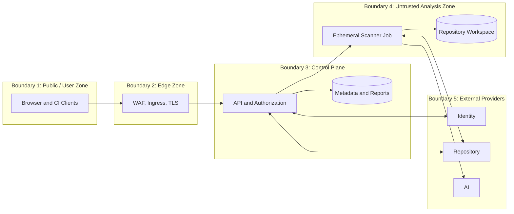

# 11. Trust Boundaries

## 11.1 Boundary Model

Trust is established independently at every boundary. Network location alone does not make a caller, payload, repository, scanner result, or AI response trusted.

## 11.2 Boundary Catalog

| Boundary | Crossing data | Principal risks | Required controls |
|---|---|---|---|
| Client to edge | Tokens, URLs, refs, report queries | Injection, abuse, credential theft, enumeration | TLS, WAF, validation, rate limits, CSRF controls |
| Edge to API | Forwarded identity/network context | Header spoofing, route bypass | Trusted proxy configuration, mTLS where required, header normalization |
| API to data stores | Metadata, reports, audit events | Injection, overprivilege, cross-tenant access | Workload identity, parameterized access, encryption, resource authorization |
| API to Kubernetes | Server-defined Job specifications | Privilege escalation, arbitrary workload creation | Namespaced RBAC, fixed templates, admission policy, audit |
| Control plane to scanner Job | Review parameters and secret references | Secret exposure, command injection | Minimal schema, immutable inputs, no arbitrary env/command fields |
| Scanner to repository | Clone request and credential | SSRF, redirects, credential exfiltration | Canonical provider endpoints, read-only short-lived token, egress policy |
| Repository to scanner | Untrusted source and filenames | Exploits, resource exhaustion, prompt injection | Isolation, limits, patched tools, no execution, safe parsing |
| Scanner to AI provider | Redacted finding context | Confidentiality loss, injection, retention | Policy gate, minimization, approved endpoint, schema validation |
| Workloads to telemetry | Logs, metrics, traces | Sensitive data leakage | Structured allowlists, redaction, access and retention controls |

## 11.3 Untrusted Analysis Zone

The scanner zone receives the highest-risk content and is intentionally separated from the control plane. It has no inbound service, no Kubernetes credential, no access to the platform database, no shared writable volume, and no ability to communicate with other scanner Jobs. Report upload uses a review-specific write capability that cannot read unrelated reports.

Scanner compromise is assumed possible. The containment objective is to prevent escape, lateral movement, credential reuse, persistent access, and cross-review data access. Dedicated nodes or sandboxed runtimes are recommended for higher-risk tenancy.

## 11.4 Control-Plane Boundary

The control plane handles identity and durable state but never consumes complete repository source. Its Kubernetes permission is limited to managing review workloads in one namespace and reading only required status. Administrative interfaces are separate from user-facing routes and require stronger authorization.

## 11.5 External Provider Boundaries

Each provider has its own trust configuration, credentials, timeouts, data policy, and audit identity. A valid identity-provider token does not establish repository permission; a valid repository-provider response does not authorize platform administration; an AI response is never trusted evidence.

Provider endpoint configuration is administrator-controlled. DNS rebinding, redirects, certificate errors, rate limits, malformed responses, and compromised credentials are handled as explicit failure modes.

## 11.6 Cross-Boundary Invariants

- Every crossing has an authenticated sender where technically possible.
- Data is validated after crossing, even if the sender is normally trusted.
- Credentials do not cross into a broader zone than required.
- Sensitive data has an explicit destination allowlist and retention rule.
- Denial behavior does not expose private resource existence.
- Correlation IDs cross boundaries; raw tokens and source do not.
- New data flows require threat-model and data-classification review.

Next: [Kubernetes Architecture](12-kubernetes-architecture.md).
