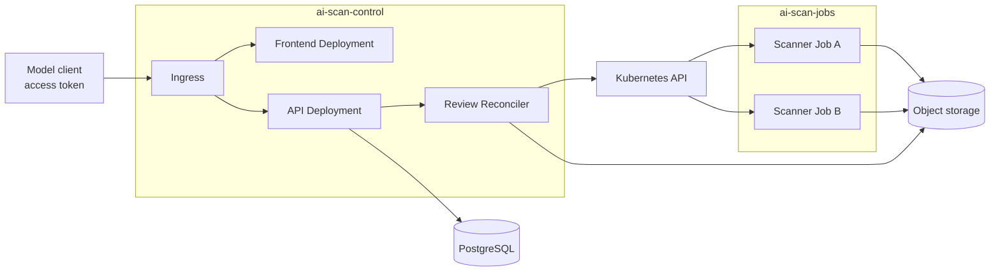

# 12. Kubernetes Architecture

**Document Version:** 1.1

**Status note (updated 2026-09-24, see [Scope Decisions Log](../SCOPE-DECISIONS.md)):** Most of this chapter is now real rather than planned. Deployed or written: namespaces, the review-api Deployment, a Tailscale egress to the LM Studio host, Pod Security `restricted`, the reports PersistentVolumeClaim and a Postgres StatefulSet (verified to start under `restricted`). **Not yet written: RBAC, NetworkPolicy, Secrets, Ingress, and the scanner-worker Job manifest** - so the parts of this chapter covering least-privilege access, network isolation and the Job lifecycle remain design, not deployment. One correction from testing: the `noexec` mount option this design relies on is **not enforced** by k3s's local-path provisioner (see `k8s-first-cluster-tests-2026-09-21.md`).

## 12.1 Namespace and Workload Design

Production uses two namespaces. `ai-scan-control` contains the frontend, backend API, and reconciler. `ai-scan-jobs` contains short-lived Semgrep Jobs. Separate namespaces allow different permissions, network rules, quotas, and node placement.

The control plane does not connect directly to scanner Pods. It creates and watches Jobs through the Kubernetes API. A scanner uploads its report to a review-specific object-storage key. The reconciler checks the Job result and report digest before updating the review in PostgreSQL.

## 12.2 Review Job Contract

Every scanner execution receives a unique Job with:

- A backend-generated run name in the form `run-<uuid-v4>`.
- The same `ai-scan.io/run-name` label on the Job and Pod.
- A `scan-<run-name>` Job name.
- A pinned scanner image digest.
- A non-root user, no added Linux capabilities, the default system-call filter, and no privilege escalation.
- A read-only root filesystem plus size-limited workspace and temporary volumes.
- CPU, memory, process, storage, execution-time, and retry limits.
- No automounted Kubernetes service-account token.
- Review-scoped configuration and secret references only.
- No container restart, no scan retry, a maximum running time, and automatic Job removal after a configured delay.

Repository source resides in a Job-local `emptyDir` or stronger ephemeral volume. No persistent volume is mounted for source processing.

The reconciler stores the run name, Job name, actual Pod name, start time, completion time, outcome, and `duration_ms` in PostgreSQL. Kubernetes may replace a Pod, so the run name is the stable execution identifier and each observed Pod is stored separately.

## 12.3 Role-Based Access Control (RBAC)

The reconciler runs in `ai-scan-control`. A Role and RoleBinding in `ai-scan-jobs` allow its service account to create, get, watch, list, and delete Jobs and to read bounded Pod status. It cannot create Pods directly, read Secrets, change RBAC, or manage cluster resources.

Semgrep Pods use a service account with no Kubernetes API permissions and token automount disabled. Frontend Pods also disable token automount. Deployment automation uses a separate identity.

## 12.4 Network Policy

Both namespaces begin with default-deny ingress and egress. Explicit policies allow:

- Ingress controller to frontend and API ports.
- Frontend to API where server-side proxying requires it.
- API to DNS, identity provider, PostgreSQL, object storage, Kubernetes API, queue, and telemetry.
- Semgrep Jobs to DNS, configured repository providers, review-scoped report upload, and telemetry.

Scanner-to-scanner, scanner-to-control-plane, scanner-to-database, public-to-scanner, and unrestricted internet traffic remain denied. The model reaches only the backend API using a short-lived token. It receives no Kubernetes credentials and has no direct path to scanner Pods or storage.

## 12.5 Scheduling and Capacity

Scanner workloads use a dedicated node pool when the cluster has enough capacity. Taints and tolerations reserve that pool for scanners. Node affinity keeps scanners away from database, ingress, and cluster-management nodes.

ResourceQuota and LimitRange bound total namespace consumption. Per-tenant concurrency limits prevent a single user from consuming all Job slots. Cluster autoscaling responds to pending approved Jobs within configured maximum capacity and cost limits.

## 12.6 Reliability and Reconciliation

The database stores the requested and reported review state. The reconciler compares it with Kubernetes Job state and repairs missed events. It handles missing Jobs, orphaned Jobs, replaced Pods, expired Jobs, stuck deletion, and API restarts.

Kubernetes Job success alone does not mean review success. The report must exist, its digest must match, and cleanup must finish. Liveness probes are used only for long-running services. Scanner Jobs use Kubernetes status and an active deadline.

## 12.7 Configuration and Secrets

Non-secret configuration is supplied through ConfigMaps or immutable release values and validated at startup. Secrets are synchronized or mounted from an external secret manager and are not committed to Helm values. Prefer workload identity and short-lived credentials over static Kubernetes Secrets.

## 12.8 Policy and Supply-Chain Enforcement

Admission policy rejects images from unapproved registries, mutable image tags, privileged containers, host access, added Linux capabilities, automounted service-account tokens, unapproved volumes, and Jobs without resource or time limits.

## 12.9 Cleanup

The scanner removes its workspace before exit. Pod deletion removes ephemeral volumes, and Kubernetes removes finished Jobs after a configured delay. A scheduled check finds stale Jobs and failed cleanup. Cleanup targets and alerts are defined in the observability design.

Next: [Observability](13-observability.md).
