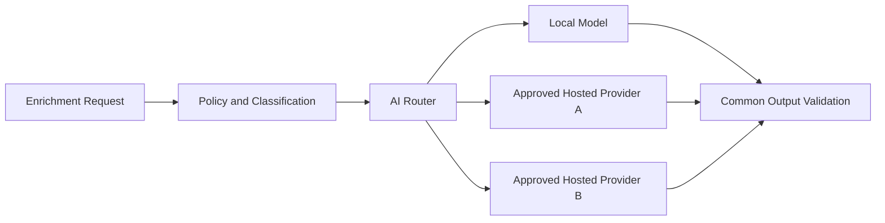

# 16. Future Architecture

## 16.1 Evolution Principles

Future capabilities must preserve the core invariants: deterministic scanners remain authoritative, source processing remains ephemeral, Deep Reports remain repository-authorized, providers remain replaceable, and untrusted repository content does not gain execution authority.

Evolution is driven by measured product need, security review, operational evidence, and ADRs—not by adding components solely for architectural complexity.

## 16.2 Near-Term Evolution

### Production Control Plane

Replace prototype persistence and identity adapters with PostgreSQL migrations, OIDC, provider applications, durable review reconciliation, idempotency, encrypted report storage, retention automation, and complete audit coverage.

### Provider Expansion

Add GitLab, Azure DevOps, and Bitbucket adapters through conformance tests covering canonical identity, permission mapping, immutable revision resolution, clone authorization, rate limiting, revocation, and error normalization.

### Enterprise Policy

Introduce tenant-specific scanner profiles, rule packs, severity thresholds, allowed AI providers, report retention, quotas, and notification policies. Policy evaluation remains explicit and versioned so every report records the rules under which it was produced.

## 16.3 Advanced Analysis

Future deterministic capabilities may include:

- Infrastructure-as-Code and Kubernetes policy analysis.
- SBOM generation and dependency graph correlation.
- License and provenance compliance.
- Container image and build-artifact scanning.
- Repository architecture and ownership-map analysis.
- Finding correlation across scanners and historical reviews.
- Diff-aware pull-request feedback combined with scheduled full scans.

Any feature requiring repository builds or execution must use a separately reviewed sandbox architecture with no implicit network or credential access.

## 16.4 AI Router

A future AI Router may select an approved model based on tenant policy, data classification, residency, task capability, availability, latency, and cost.

Routing must be deterministic enough to audit, must never downgrade privacy requirements to improve availability, and must expose fallback behavior. Model evaluation, prompt versions, and provider policy are first-class configuration. ADR-008 governs this proposal before implementation.

## 16.5 Multi-Agent Analysis

Specialized AI agents could analyze security, architecture, quality, dependencies, and remediation, with a final synthesis stage. This remains exploratory because additional agents increase disclosure surface, prompt-injection paths, latency, cost, and provenance complexity.

If adopted, agents receive bounded immutable inputs, have no autonomous infrastructure or repository-write tools, and produce schema-validated outputs. Deterministic findings remain preserved and attributable.

## 16.6 Scale and Tenancy Evolution

As adoption grows, the architecture may introduce regional control planes, multi-cluster scanner capacity, tenant-specific namespaces or clusters, queue partitioning, capacity classes for monorepos, and regional report stores. Tenant placement follows residency and isolation policy.

The backend may extract independently scaled services only when data ownership and operational boundaries are clear. Candidate extractions include Job reconciliation, report generation, and provider integration, but the cost of distributed state and networking must be justified.

## 16.7 Developer Workflow Integration

Provider applications may publish status checks, SARIF, issue links, and pull-request annotations. These integrations must avoid exposing Deep Report evidence to unauthorized pull-request viewers. Automated remediation begins as suggested patches and never commits or merges without explicit user approval and repository authorization.

## 16.8 Continuous Architecture Governance

Architecture fitness functions will validate interface compatibility, forbidden dependencies, manifest security, network policy, report sanitization, data retention, authorization, and provider conformance. Documentation, diagrams, ADRs, threat models, and runbooks are versioned with implementation changes.

## 16.9 Target Outcome

The long-term platform becomes a policy-driven, provider-independent repository assurance service that can operate in cloud, on-premises, and regulated environments. Its value comes from consolidating trustworthy evidence and actionable guidance while maintaining strict control of source code, identity, and execution risk.

Return to the [HLD index](README.md).
