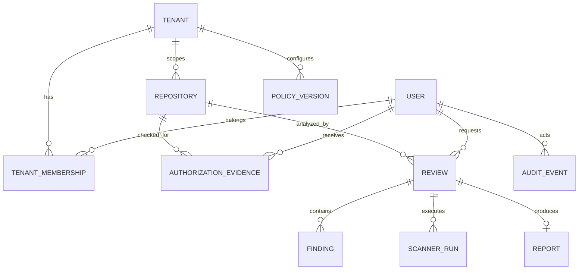

# Database Design

**Project:** AI Scan Repos  
**Document Version:** 1.0  
**Status:** Draft  
**Primary Database:** PostgreSQL

---

## 1. Purpose

PostgreSQL stores transactional platform metadata, authorization evidence, normalized finding indexes, report references, configuration versions, and audit events. Repository working copies, clone credentials, complete prompts, raw secret values, and large report bodies are not stored in relational tables.

Encrypted object storage holds immutable report artifacts. The database stores opaque object references and integrity metadata.

## 2. Design Principles

- Use UUIDs as opaque primary keys.
- Enforce tenant and ownership scope in every repository query.
- Store immutable repository identity and commit SHA for reproducibility.
- Keep lifecycle transitions transactional and optimistic-lock protected.
- Separate public Summary metadata from confidential Deep Report access.
- Use append-only audit semantics.
- Apply retention by data class rather than one global deletion period.
- Never store reusable repository or AI credentials.

## 3. Logical Entity Model

## 4. Core Tables

### 4.1 `users`

| Column | Type | Notes |
|---|---|---|
| `id` | UUID PK | Internal identity |
| `issuer` | TEXT | Trusted OIDC issuer |
| `provider_subject` | TEXT | Immutable external subject |
| `display_name` | TEXT | Non-authoritative UI attribute |
| `status` | ENUM | active, suspended, deleted |
| `created_at`, `updated_at` | TIMESTAMPTZ | UTC timestamps |

Unique constraint: `(issuer, provider_subject)`.

### 4.2 `tenants` and `tenant_memberships`

Tenants define policy and data boundaries. Membership maps users to tenant roles. Roles do not replace repository-level permission checks.

Membership unique constraint: `(tenant_id, user_id)`. Role assignments should use a constrained role table or enum and be audited.

### 4.3 `repositories`

| Column | Type | Notes |
|---|---|---|
| `id` | UUID PK | Internal repository key |
| `tenant_id` | UUID FK | Owning policy boundary |
| `provider` | ENUM/TEXT | github, gitlab, etc. |
| `external_id` | TEXT | Canonical provider repository ID |
| `display_name` | TEXT | Presentation only |
| `visibility` | ENUM | public, private, internal, unknown |
| `web_url` | TEXT | Canonical credential-free URL |
| `created_at`, `updated_at` | TIMESTAMPTZ | Metadata timestamps |

Unique constraint: `(tenant_id, provider, external_id)`.

### 4.4 `authorization_evidence`

Stores a bounded proof that a subject was checked for an operation. Columns include tenant, user, repository, normalized permission, operation, decision, policy version, provider check time, and expiration. Provider tokens and raw responses are excluded.

Index: `(user_id, repository_id, operation, expires_at)`.

### 4.5 `reviews`

| Column | Type | Notes |
|---|---|---|
| `id` | UUID PK | Review identifier |
| `tenant_id` | UUID FK | Tenant scope |
| `repository_id` | UUID FK | Canonical repository |
| `requester_id` | UUID FK nullable | Nullable for permitted anonymous summary |
| `requested_ref` | TEXT | Validated user/provider ref |
| `commit_sha` | TEXT | Immutable resolved revision |
| `report_level` | ENUM | summary, deep |
| `status` | ENUM | Lifecycle state |
| `status_version` | BIGINT | Optimistic lock |
| `policy_version_id` | UUID FK | Applied policy |
| `idempotency_key_hash` | BYTEA nullable | Scoped duplicate prevention |
| `error_code` | TEXT nullable | Sanitized stable classification |
| lifecycle timestamps | TIMESTAMPTZ | created, queued, started, completed, expires |

Indexes:

- `(tenant_id, created_at DESC)`.
- `(requester_id, created_at DESC)`.
- `(status, created_at)` for reconciliation.
- `(repository_id, commit_sha, created_at DESC)`.

### 4.6 `scanner_runs`

One row per scanner attempt records review, scanner identity/version, rule-pack version, status, start/end time, exit classification, findings count, truncation, and sanitized error code. It proves coverage and prevents a failed scanner from looking clean.

Unique constraint: `(review_id, scanner_name, attempt)`.

### 4.7 `findings`

Normalized findings store review, fingerprint, scanner/rule, category, scanner severity, confidence, title, relative path, bounded line range, redacted evidence, remediation, AI priority, AI status, and provenance schema. Large narrative fields may remain only in the encrypted Deep Report object while the database stores searchable summaries.

Indexes:

- `(review_id, scanner_severity)`.
- `(review_id, fingerprint)` unique where appropriate.
- `(tenant_id, category, created_at)` if cross-review analytics are enabled.

Detected secret values are never indexed or persisted.

### 4.8 `reports`

| Column | Type | Notes |
|---|---|---|
| `review_id` | UUID PK/FK | One finalized report set per review |
| `summary_object_key` | TEXT | Opaque object reference |
| `deep_object_key` | TEXT nullable | Confidential object reference |
| `summary_digest` | BYTEA | Integrity hash |
| `deep_digest` | BYTEA nullable | Integrity hash |
| `schema_version` | TEXT | Artifact contract |
| `ai_status` | ENUM | disabled, unavailable, completed, rejected |
| `generated_at`, `expires_at` | TIMESTAMPTZ | Lifecycle timestamps |

Object keys are never returned directly to unauthorized clients.

### 4.9 `audit_events`

Audit records contain event UUID, tenant, optional actor, actor type, action, resource type/ID, authorization decision, policy version, outcome, request ID, safe metadata JSON, and occurred time. Application updates/deletes are denied; archival uses a controlled process.

Index by `(tenant_id, occurred_at DESC)`, `(actor_id, occurred_at DESC)`, and `(resource_type, resource_id, occurred_at)`.

### 4.10 `policy_versions`

Policy documents are immutable after activation. A version contains tenant, schema version, content digest, non-secret configuration JSON, status, creator, approval, and effective timestamps. Reviews reference the applied version.

## 5. Tenant Isolation

Every tenant-owned table includes `tenant_id` even when derivable through a join, enabling explicit query scoping and optional PostgreSQL row-level security. Application repositories require a tenant context; unscoped list methods are forbidden outside audited administration.

Object storage prefixes and encryption/access policies also include tenant scope. Database isolation alone is not sufficient.

## 6. Transactions and Concurrency

State transitions update `reviews` with both current status and `status_version` predicates. A zero-row update indicates a conflict and triggers reconciliation rather than blind overwrite.

Review creation transactionally stores canonical request data, authorization evidence reference, initial audit event, and idempotency mapping. Kubernetes Job creation occurs after commit and is repaired by the reconciler if delivery is uncertain.

Report finalization becomes visible only after object digest verification and a transaction that creates report metadata, updates terminal review state, and appends the audit event.

## 7. Retention and Deletion

Retention policy defines separate periods for reviews, findings, report objects, authorization evidence, audit events, and backups. A deletion worker marks eligible records, deletes dependent objects idempotently, records an audit tombstone, and then removes or anonymizes database rows according to policy.

Repository source is not part of database retention because it is never stored. Backup deletion delay is documented and protected by encryption/key lifecycle.

## 8. Encryption and Access

Connections require TLS. Storage and backups are encrypted with controlled keys. Database roles are separated for migration, runtime read/write, reconciliation, reporting, audit append, and read-only operations. Runtime roles cannot change schema or audit history.

Sensitive columns should use application- or database-level encryption when threat and compliance analysis requires protection beyond disk encryption. Encryption keys remain outside the database.

## 9. Migration Strategy

Alembic manages reviewed migrations. Production changes use expand/migrate/contract sequencing:

1. Add backward-compatible structures.
2. Deploy code capable of old and new schema.
3. Backfill with bounded observable jobs.
4. Switch reads/writes.
5. Remove obsolete structures in a later release.

Every migration has rollback or forward-recovery guidance and is tested against representative data volume.

## 10. Backup and Recovery

PostgreSQL uses automated encrypted backups and point-in-time recovery appropriate to the environment. Object storage uses versioning/replication where policy requires it. Restoration tests verify database-to-object consistency, report digests, encryption keys, tenant access, and reconciliation of reviews active at the recovery point.
