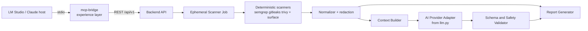

# 14. MCP Adaptation Plan — `code-review-mcp` → AI Scan Repos

**Project:** AI Scan Repos
**Document Version:** 1.0
**Status:** Proposed
**Inputs:** `HANDOFF.md` (code-review-mcp), HLD/LLD documents 01–13
**Convention:** Like `HANDOFF.md`, this file is written to seed a future working
session without re-deriving anything. Read `HANDOFF.md` first (existing system),
then this plan (how it becomes part of the platform).

**Reference key used below:**
[INTRO] 01-introduction · [SOL] 02-solution-overview · [CTX] 03-system-context ·
[COMP] 04-component-architecture · [PLAT] 05-platform-deployment ·
[TM] 06-threat-model · [API] 07-api-specification · [DB] 08-database-design ·
[AI] 09-ai-analysis-engine · [K8S] 09-kubernetes-design ·
[DEP] 10-deployment-guide · [OBS] 11-monitoring-observability ·
[RM] 12-roadmap · [FUT] 13-future-enhancements

---

## 1. Purpose

`code-review-mcp` is a complete, verified, **AI-first** vertical slice: clone →
manifest → LLM reviews raw code → merged report. AI Scan Repos is a
**deterministic-first** platform: pinned scanners are the authoritative source
of findings; AI is an optional, policy-gated enrichment layer [INTRO 1.7,
AI 9.1].

This plan defines how the existing project is adapted — which parts are reused,
which are inverted, which are retired — and sequences the work against the
platform roadmap [RM]. Nothing in this plan removes the local LM Studio
workflow: it becomes the approved **local provider path** [AI 9.7] behind a
common adapter interface, and the HANDOFF §10 demo prompt remains a permanent
acceptance test.

---

## 2. Positioning Decision (D1): split, don't port

The MCP contributes in **two directions at once**:

1. **Internal donation** — the pipeline internals (`repo_ingest.py`,
   `surface.py`, `llm.py`, `review.py`, mock server, tests) are refactored into
   analysis-plane components: clone phase, quality scanner plugin, AI Provider
   Adapter, Context Builder utilities, Report Generator, and the evaluation
   harness.
2. **External survival** — the MCP *server* survives as **`mcp-bridge`**: a
   thin experience-layer client that lets an LLM host (LM Studio/Gemma, Claude,
   Claude Code) drive the platform through the REST API. It maps exactly to the
   **"CI/CD Integration" actor**: a non-human identity with narrow scope
   [CTX 3.2]. The bridge holds no clone credentials, calls no LLM, and writes
   no reports — the platform does all of that.

**Why this works:** the LM Studio 60-second MCP tool cap forced the async job
API (`start_review` / `get_review_status`, HANDOFF §7.5). The platform API is
already shaped identically — `202 Accepted` + status polling + report retrieval
[API 3.1–3.5]. The hard-won interaction pattern transfers 1:1.



**Migration strategy (strangler):** the bridge gets a `BRIDGE_MODE=local|platform`
switch. In `local` mode it invokes the worker pipeline in-process (today's
behavior, refactored); in `platform` mode it calls the REST API. LM Studio demos
never break during the migration.

---

## 3. Architectural Inversions (contract changes)

These are the non-negotiable deltas between the two systems. Every workstream
task traces back to one of these.

| # | Current (`HANDOFF.md`) | Target (platform) | Source |
|---|---|---|---|
| I1 | AI-first: "the server contains no AI... all intelligence is the model"; LLM reviews raw file content | Deterministic-first: scanners are authoritative; AI explains and prioritizes their findings | INTRO 1.7, AI 9.1 |
| I2 | Coverage is achieved by the LLM (brief mode batches heads of *all* files) | Coverage is achieved by deterministic full-revision scans; AI is never the coverage mechanism | INTRO 1.6 driver 2, RM P1 |
| I3 | Gemma is the MCP **host** — the model autonomously picks tools | The model gets **no tools**; prompts are server-owned and versioned; repository content is delimited as untrusted data | AI 9.4 |
| I4 | Whole-file and packed multi-file prompts | Minimized, finding-scoped context under a strict byte/token budget; whole-repo prompts prohibited by default | AI 9.3 |
| I5 | LLM output **is** the report | AI output is advisory enrichment; it must not remove, downgrade, or alter a deterministic finding; `scanner_severity` and `ai_priority` are separate fields | AI 9.6, COMP 4.2 |
| I6 | No authentication; any caller can review any URL | OIDC identity + live repository-provider authorization; Deep reports gated on verified repo permission | CTX 3.2, TM 5.1 |
| I7 | Reports on a shared volume; unversioned ad-hoc schema | Versioned finding/report schemas, encrypted object storage, digests, Summary/Deep sanitization split | SOL 2.4, DB 4.7–4.8 |
| I8 | One Docker container does everything | Control plane (Deployments) vs. one ephemeral scanner Job per review; bridge lives in the experience layer | SOL 2.1, K8S §1 |
| I9 | In-memory job registry, one job at a time | Durable review state machine in PostgreSQL, optimistic locking, reconciler, idempotency keys | COMP 4.3, DB 4.5 |

---

## 4. Asset Disposition Map (file by file)

> **Path note (2026-07-30).** The repository has since been split into three
> components — `mcp-server/`, `backend/`, `frontend/` (see
> [18-team-setup-guide](18-team-setup-guide.md)). Bare filenames in the
> "Current asset" column live under `mcp-server/src/code_review_mcp/`, and
> `tests/*` under `mcp-server/tests/`. Two entries have moved on since this
> plan was written: `review.py`'s orchestration was extracted into
> `pipeline.py` (the shared engine both front ends call), and WS3's control
> plane exists as `backend/` ([17-review-api](17-review-api.md)).

| Current asset | Destination | Verdict | Notes |
|---|---|---|---|
| `config.py` | `libs/policy` + plugin exclusion lists | **Refactor** | Extension allowlist / skip-dirs / size caps become the seed of the Context Builder exclusion policy [AI 9.3]; env-var override pattern kept; later superseded by `policy_versions` [DB 4.10] |
| `repo_ingest.py` | scanner-worker **clone phase** | **Refactor** | Keep `--depth 1`, file/size limits, manifest concept. Add: immutable `commit_sha` recording, provider allowlist + SSRF guard [TM 5.2], short-lived credential injection [CTX 3.4]. `_run_git`/`_kill_tree` Windows hardening → dev-harness appendix only (Linux Jobs unaffected) |
| `surface.py` | **quality scanner plugin** (`surface@vN`) | **Reuse** | It is already deterministic. Wrap in the Scanner Plugin interface; emit normalized findings; heuristic score feeds the Summary `quality` score [API 3.5]. Satisfies the Phase-1 "quality adapter" requirement [RM P1] |
| `llm.py` | **AI Provider Adapter** (openai-compatible family: LM Studio / Ollama / vLLM) | **Refactor** | Keep: streaming stall-watchdog (`REVIEW_STALL_TIMEOUT`), `JSON_ENFORCEMENT` retries, empty-response budget-doubling, `resolve_model()` (internal only). Add: policy-profile input instead of model name [AI 9.5], correlation IDs, circuit breaker [AI 9.8], **no prompt/response logging** [OBS §4] |
| `review.py` | **Split three ways** | **Split** | Chunk/budget utilities → Context Builder fragment packing; `render_markdown` → Report Generator; orchestration (`review_manifest`) → retired, the platform Review Service owns lifecycle [COMP 4.3]. `pack_digest_batches` retired as default (I4) |
| `server.py` | **`mcp-bridge`** | **Rewrite (thin)** | Tool surface preserved (see §7) but every tool becomes a REST call; in-memory job registry retired (I9). `_progress_payload` concept survives as client-side rendering of the status response |
| `cli.py` | Dev harness | **Keep** | Targets the local stack; useful for LLM-free pipeline testing |
| `tests/mock_llm_server.py` | Provider contract tests + **hostile-provider fixtures** | **Extend** | Add responses that reflect canary secrets, unsafe links, fabricated findings — required fixtures for [TM 5.4] validation |
| `tests/test_pipeline.py` (49 tests) | Migrated per-component | **Keep green** | The 49 tests are the regression floor during refactoring |
| `Dockerfile` | Split: **scanner-job image** + **bridge image** | **Rewrite** | Job image must satisfy the K8s template: non-root, read-only rootfs, no SA token, dropped capabilities, emptyDir workspace, digest-pinned [K8S §4] |
| `/reports` volume | Object storage + digests | **Replace** | Opaque object keys, integrity hashes, server-side authorization [DB 4.8, TM 5.5] |
| `docs/DOCUMENTATION.*.md` | Superseded by platform docs | **Archive** | Keep as historical reference for the standalone tool |

---

## 5. Target Component Designs

### 5.1 AI Provider Adapter (from `llm.py`)

Implements the common interface [AI 9.5]. Request/response contract (Pydantic):

```python
class EnrichmentRequest(BaseModel):
    task_type: Literal["finding_explanation", "prioritization", "summary_overview"]
    model_policy: str                  # policy PROFILE id — never a vendor model name (AI 9.5)
    findings: list[NormalizedFinding]  # the evidence being enriched
    context: list[ContextFragment]     # minimized fragments, already budget-bounded
    schema_version: str
    timeout_s: float
    correlation_id: str

class EnrichmentResponse(BaseModel):
    items: list[FindingEnrichment]     # keyed by finding fingerprint
    provider_id: str
    model_id: str                      # actual model (HANDOFF lesson: record reality)
    latency_ms: int
    token_usage: TokenUsage | None
    safety_status: Literal["ok", "failed_validation", "rejected"]
```

Carried over from `llm.py` unchanged in spirit: stall-watchdog liveness (never a
total-duration timeout), bounded JSON retries, empty-response budget-doubling
(the Gemma reasoning-token lesson), `resolve_model()` as an *internal* LM Studio
quirk handler. New: concurrency limit surfaced as adapter config (default 1 —
the serial-LM-Studio lesson, now aligned with [AI 9.8]), circuit breaker, and a
hard logging rule: prompts and responses are never logged [OBS §4].

One adapter class covers the openai-compatible family (LM Studio, Ollama, vLLM),
matching the initial adapter list in [AI 9.5].

### 5.2 Context Builder (findings-driven)

The inversion of I4. Input is **normalized findings**, not files:

- For each finding (or fingerprint-clustered group), extract a window of
  `start_line − N .. end_line + N` from the workspace, within a strict byte/token
  budget. `review.py` chunking utilities are repurposed for fragment packing.
- Exclusions (hard): binary files, generated content, dependency directories,
  **detected secret values**, identified personal data, tenant-prohibited paths
  [AI 9.3]. `config.py` skip-dirs/allowlists seed this policy.
- Whole-repository prompts are prohibited by default. Any revival of brief-style
  repo summarization requires the "approved hierarchical process" ADR (see §12).

### 5.3 Schema & Safety Validator

Extends today's JSON enforcement into the full output contract [AI 9.4, 9.6]:

1. Pydantic schema + size/type bounds (exists today — keep).
2. **Reference check:** enrichment items may only reference fingerprints that
   were in the request ("unsupported claims" control).
3. **Secret-reflection scan:** run detection rules + seeded canary values over
   AI output before it is merged [TM 5.3, 5.4].
4. **Link policy:** strip or reject URLs outside an approved scheme/domain list.
5. **Severity immutability:** the enrichment schema has no severity field —
   only `ai_priority`. The merge step cannot touch `scanner_severity`.

### 5.4 Quality scanner plugin (from `surface.py`)

`surface.py` becomes the first in-house plugin behind the Scanner Plugin
interface [COMP 4.2]: invoked with argument arrays (no shell), pinned version,
bounded output, emits `NormalizedFinding` records, and one `scanner_runs`
coverage row per attempt [DB 4.6] so a failed scan can never look clean —
the "honest reporting" instinct from HANDOFF §8, now structural.

### 5.5 Clone phase (from `repo_ingest.py`)

Runs first inside the Job. Deltas: resolve and record immutable `commit_sha`
[DB 4.5]; provider allowlist + canonical repo identity + IP-range denial +
redirect validation (currently *any* URL is cloned — SSRF gap, [TM 5.2]);
credentials arrive as short-lived review-scoped grants via mount/identity,
never in arguments or logs [K8S §9, TM 5.3]. Existing size/file caps
(`REVIEW_MAX_FILES`, `REVIEW_MAX_FILE_BYTES`) map to the DoS controls in
[TM 5.2].

### 5.6 Report Generator (from `render_markdown`)

One normalized result model → two server-generated views [SOL 2.4]:
**Summary** (aggregates, scores, coverage — no paths/lines/snippets) and
**Deep** (findings with redacted evidence + AI enrichment). Every artifact gets
`schema_version` and a digest recorded at finalization [DB 4.8]. The dual
`<id>.json` + `<id>.md` habit survives as the two artifact formats of the Deep
view.

### 5.7 `mcp-bridge` (from `server.py`)

Pure REST client with the platform as backend. Authenticates with a workload
identity (CI-integration actor class, [CTX 3.2]); per-user repository
authorization happens in the platform, not the bridge. Keeps the context-safe
consumption patterns that were invented for small-context hosts:
`get_report_entry` pagination and the notes scratchpad remain **bridge-local**
features. Long-poll stays ≤ 40 s (under the LM Studio 60 s cap). Blocking-mode
tools are not exposed at all in platform mode.

---

## 6. Mode Mapping

| Current mode | Platform equivalent | Rationale |
|---|---|---|
| `quick` (surface scan + 1 AI overview) | `report_level=summary`: deterministic scanners + optional `summary_overview` enrichment task | The overview call becomes compliant because its input is **aggregated findings**, not raw code |
| `brief` (batched heads of all files) | **Retired as an AI path** | Violates I4/[AI 9.3]. Full coverage is now the deterministic scanners' job. Repo-level AI summarization = future ADR (§12) |
| `deep` (per-file LLM review, `files=`) | `report_level=deep`: per-finding enrichment | `files=` glob targeting survives as enrichment *scoping* config, not as "which files the LLM reads wholesale" |

The conceptual shift in one sentence: **the LLM used to provide coverage; now
scanners provide coverage and the LLM provides explanation on demand.**

## 7. Tool Surface Mapping (bridge)

| MCP tool | Platform mapping | Fate |
|---|---|---|
| `start_review(...)` | `POST /api/v1/reviews` (`review_id` → `Idempotency-Key`) [API 3.1] | Keep |
| `get_review_status(job_id, wait_seconds)` | `GET /api/v1/reviews/{id}` + ETag; bridge long-polls client-side [API 3.2] | Keep |
| `get_report(report, ...)` | `GET /reviews/{id}/report?view=summary\|deep` [API 3.5] | Keep |
| `get_report_entry(report, index)` | Bridge-local pagination over Deep `findings[]` | Keep (bridge feature) |
| `append_report_notes` / `read_report_notes` | Bridge-local scratchpad | Keep (bridge feature) |
| `list_reports()` | `GET /api/v1/reviews?status=completed` [API 3.3] | Keep |
| `check_llm()` | Platform readiness + AI policy state (safe subset) [API 3.7, OBS 3.3] | Reshape |
| `ingest_repository_only(...)` | No public platform equivalent (would leak repo data) | Dev/local mode only |
| `review_repository(...)` (blocking) | None — 60 s cap + no synchronous platform op | Retire from bridge; CLI-only |

---

## 8. Workstreams

Each workstream lists donated assets and outcome-based exit criteria, anchored
to roadmap phases [RM]. Order within WS1–WS2 is security-value-first.

### WS0 — Foundation (entry to RM Phase 0/1)

- `git init` — HANDOFF states the project is **not under version control**;
  the platform mandates ADRs, CI, signed immutable artifacts [DEP §5]. This
  blocks everything else.
- Repo layout (monorepo):

```text
ai-scan-repos/
  services/
    api/                # FastAPI control plane (new)
    scanner-worker/     # analysis plane (from repo_ingest, surface, review, llm)
    mcp-bridge/         # experience plane (from server.py)
  libs/
    findings/           # NormalizedFinding, fingerprints, redaction
    ai_enrichment/      # adapter interface, context builder, validator
    policy/             # config/policy models (from config.py)
  docs/adr/
  tests/
```

- Import existing code as packages; CI runs the 49 tests; ADR-000 records the
  split decision (this document).
- **Exit:** CI green on imported code; ADR-000 merged.

### WS1 — Deterministic core (RM Phase 1)

- Scanner Plugin interface; wrap pinned **Gitleaks first** (highest security
  value), then Semgrep, Trivy; port `surface.py` as the quality plugin.
- `NormalizedFinding` schema v1 mirroring [DB 4.7]: fingerprint, scanner/rule,
  category, `scanner_severity`, confidence, title, path, line range, redacted
  evidence, remediation, `ai_*` fields, provenance.
- Fingerprint algorithm designed for cross-revision stability from day one
  (future lifecycle needs it, [FUT §5]) — ADR-D.
- **Redaction at normalization** — secrets are masked *before* anything
  downstream (reports, context, logs) can see them. Seeded canary tests
  [TM 5.3]. This closes the current gap where `surface.py` detects secrets but
  the manifest still ships them to the LLM.
- `scanner_runs`-style coverage records.
- **Exit:** the e-voting test repo (123 files, commit `5a164c3e`) produces a
  truthful normalized report containing the 4 known ground-truth findings;
  canary secret values appear nowhere in report, logs, or artifacts; a
  deliberately failed scanner is visibly reported as missing coverage.

### WS2 — AI inversion (RM Phase 1 optional-AI → Phase 5 target)

- Extract the adapter (§5.1) from `llm.py`; port `mock_llm_server.py` into
  contract tests; add hostile-provider fixtures.
- Context Builder (§5.2), Validator (§5.3), identity-preserving merge, and the
  full `ai_status` state set: `not_requested | disabled_by_policy | unavailable
  | failed_validation | completed` [AI 9.8, DB 4.8].
- Policy gate v0: simple enabled/disabled + provider allowlist per config;
  full tenant policy arrives with the control plane.
- **Exit:** AI-off run completes a full deterministic report; AI-on adds
  labeled enrichment; a prompt-injection repository (reuse the Hermes-trap
  methodology from the earlier harness work) cannot alter, remove, or downgrade
  any deterministic finding; canary secrets are provably absent from adapter
  requests (asserted at the adapter boundary) and responses.

### WS3 — Control-plane alignment (RM Phase 1→2)

- Review state machine (`requested → authorizing → queued → running →
  finalizing → completed/failed/cancelled/timed_out`) [COMP 4.3], durable in
  SQLite→PostgreSQL, optimistic `status_version` [DB 4.5].
- REST v1 subset: create / status / report / list / cancel, Idempotency-Key,
  sanitized `error_code`s, RFC 9457 problem details [API].
- Refactor bridge onto REST (`BRIDGE_MODE=platform`).
- **Exit:** the HANDOFF §10 real-hardware prompt works end-to-end through
  Gemma → bridge → API → worker → report, with truthful terminal state.

### WS4 — Kubernetes packaging (RM Phase 2)

- Split images (§4); job image satisfies the template in [K8S §4]:
  `runAsNonRoot`, read-only rootfs, no SA token, dropped capabilities,
  emptyDir workspace/tmp, `activeDeadlineSeconds`, `backoffLimit: 0`,
  digest-pinned.
- Reports upload to object storage with digest verification before the review
  is finalized [DB §6]; the `/reports` volume mount disappears.
- `host.docker.internal` removed from the job path — the AI endpoint is
  config + egress allowlist [K8S §6]; local-dev compose keeps the old wiring.
- **Exit:** the relevant subset of the [K8S §14] validation checklist passes on
  a local cluster (kind/minikube): no DB access from the Job, no SA token,
  egress limited, workspace gone after every terminal path.

### WS5 — Governance & evaluation (RM Phase 5)

- Prompt templates, model policy profiles, schemas, and eval datasets become
  versioned artifacts [AI 9.9]; report provenance records them.
- Evaluation dataset seeded from the e-voting ground truth (§9).
- Prompt-injection suite, secret-leakage suite, grounding/remediation-quality
  scoring; latency and cost tracked per [OBS 3.3].
- **Exit:** RM Phase 5 exit criteria are measurable: injection and
  secret-reflection evals meet thresholds; AI failure never blocks a
  deterministic report; users can distinguish scanner facts from AI inference.

### WS6 — Observability & audit hooks (RM Phase 2→4)

- `_progress_payload` semantics → phase-duration metrics (clone, per-scanner,
  normalization, AI, upload, cleanup) [OBS 3.2].
- Enforce the forbidden-content log policy (no prompts, responses, source,
  secret values, repo URLs as labels) with redaction tests [OBS §2, §4].
- Audit event stubs for review lifecycle and report access [OBS §6].
- **Exit:** redaction canary tests pass; dashboards show phase latency for a
  real review.

---

## 9. Evaluation Dataset Seed

`https://github.com/hadsahar/Secured-e-voting-system` @ `5a164c3e` — known
ground truth becomes the first eval set [AI 9.9]:

| Known finding | Expected detector | Eval purpose |
|---|---|---|
| Hardcoded Django `SECRET_KEY` | gitleaks / semgrep | Grounding + **canary**: the value must never appear in prompts, AI output, logs, or Summary |
| WandB API key in `debug.py` | gitleaks | Secret-reflection canary |
| Broken RSA (primes 3 & 11) in SMPC | semgrep rule (custom) or surface rule | Explanation-quality eval (does enrichment explain *why* it's broken?) |
| Commented-out admin permissions | surface / quality plugin | Prioritization eval (AI should rank this correctly against noise) |

`mock_llm_server.py` grows a hostile mode returning: reflected canary secrets,
unsafe links, enrichment referencing nonexistent fingerprints, and attempts to
set severity — each must be caught by the Validator [TM 5.4].

---

## 10. Security Deltas to Close (current MCP vs. threat model)

| Gap in current MCP | Threat ref | Fix | WS |
|---|---|---|---|
| Detected secrets still shipped to the LLM inside the manifest | TM 5.3 | Redaction at normalization, before context build; canaries | WS1 |
| Any URL is cloned (SSRF / internal endpoints / metadata services) | TM 5.2 | Provider allowlist, canonical identity, IP-range denial, redirect validation | WS1 |
| No authN/authZ on tools; anyone can review anything | TM 5.1 | Bridge uses workload identity; platform authorizes per request | WS3 |
| Reports on a shared volume, no access control, no integrity | TM 5.5 | Object store, opaque keys, digests, server-side authorization | WS4 |
| Prompts/responses potentially observable in logs | OBS §4 | Adapter logging policy + redaction tests | WS2/WS6 |
| No provenance (prompt/model/policy versions) in output | AI 9.9 | Provenance block in report; versioned prompts | WS5 |
| LLM output *is* the report → model can silently drop findings | TM 5.4, AI 9.6 | Identity-preserving merge; severity split; reference check | WS2 |

---

## 11. Gotcha Carry-Over Ledger (HANDOFF §8 → platform)

| Lesson | Fate in the platform |
|---|---|
| Git for Windows deadlocks in MCP servers | Irrelevant inside Linux Jobs; `_run_git` hardening kept only in the Windows dev harness; documented as an appendix so it is never re-learned |
| LM Studio MCP tool cap = 60 s | Still governs the **bridge**: keep ≤ 40 s long-poll, never expose blocking tools |
| Small models pick tools by name | Applies to bridge tool naming; blocking variants stay hidden/dev-only |
| Gemma reasoning tokens eat the budget | Lives on inside the adapter's empty-response budget-doubling retry |
| Serial LM Studio + concurrency = empty responses | Adapter concurrency config, default 1; consistent with [AI 9.8] concurrency limits |
| User hot-swaps models; `resolve_model()` | Replaced at the interface by **model policy profiles** [AI 9.5]; `resolve_model()` remains an internal LM Studio quirk handler. **Note: this is not the AI Router** — see §12 |
| Honest reporting of outcomes | Now structural: `scanner_runs` coverage, truthful terminal states, `ai_status` degradation labels |

---

## 12. Open Decisions (ADRs required before the relevant WS)

| ADR | Question | Blocks |
|---|---|---|
| ADR-000 | Accept the split architecture in this document | WS0 |
| ADR-A | Bridge identity: static service token vs. OIDC client-credentials workload identity | WS3 |
| ADR-B | Repository-level AI summarization (hierarchical process) — the only sanctioned way to revive brief-mode-like behavior [AI 9.3] | Any brief revival |
| ADR-C | Formal approval statement for local providers (LM Studio/Ollama) under the [AI 9.7] policy language — local reduces disclosure but still requires isolation, patching, validation | WS2 prod use |
| ADR-D | Fingerprint algorithm and its cross-revision stability guarantees [FUT §5] | WS1 |
| ADR-008 | AI Router — explicitly **deferred**, per [AI 9.9, FUT §7]. `resolve_model()` must not grow into an unofficial router | — |

---

## 13. Retired Behaviors (explicit, so they aren't accidentally rebuilt)

- Brief mode's pack-all-file-heads prompting as a default path (I4).
- The LLM as the authority on what the report contains (I5).
- The in-memory one-job-at-a-time registry as the state of record (I9).
- `review_repository` blocking tool in any hosted context.
- Report delivery via shared volume mount in platform mode.
- Unauthenticated review submission (I6).

---

## 14. Immediate Next Steps (first five PRs)

1. **PR-1:** `git init`, monorepo layout, import existing code unchanged, CI
   with the 49 tests green, ADR-000.
2. **PR-2:** `libs/findings` — `NormalizedFinding` v1 + fingerprint (ADR-D
   draft) + normalizer skeleton.
3. **PR-3:** Gitleaks plugin + redaction-at-normalization + canary secret
   tests (largest security payoff first, closes the top row of §10).
4. **PR-4:** Semgrep + Trivy plugins + `surface` port + coverage records; WS1
   exit test against the e-voting repo.
5. **PR-5:** Adapter extraction from `llm.py` behind the §5.1 interface +
   `mock_llm_server.py` contract tests (hostile fixtures stubbed).

After PR-5 the project has a deterministic-first pipeline with optional local
AI — i.e., the RM Phase 1 analysis-plane slice — while today's LM Studio demo
keeps working through `BRIDGE_MODE=local` the entire time.
