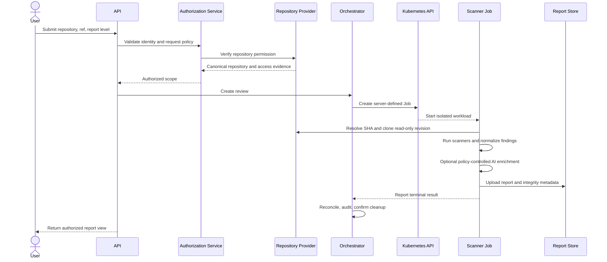

# 6. Repository Analysis Flow

## 6.1 End-to-End Sequence

## 6.2 Request Intake

The API accepts a provider-supported HTTPS repository reference, optional ref or pull-request identifier, requested report level, and optional idempotency key. It rejects embedded credentials, unsupported hosts, malformed refs, oversized payloads, and client-supplied execution settings.

The repository adapter converts the reference into a canonical provider and repository identifier. Canonicalization occurs before authorization and deduplication to prevent alternate URL forms from bypassing policy.

## 6.3 Authorization and Revision Resolution

Summary access follows configured public-repository policy. Deep Report requests require authenticated identity and repository-provider permission. The authorization result records subject, canonical repository ID, requested operation, provider evidence timestamp, and decision—not reusable provider credentials.

The selected branch, tag, or pull request is resolved to an immutable commit SHA. The SHA becomes the review input and audit reference so later branch changes do not alter the meaning of a completed report.

## 6.4 Job Creation

The orchestrator creates a Job from a server-owned template. The client cannot control the image, command, service account, volumes, node selection, namespace, or arbitrary environment variables. The Job receives only opaque review identity, immutable repository identity, revision, policy reference, and secret references required for that review.

Creation is idempotent. Reconciliation handles cases in which the database transaction succeeds but Kubernetes creation is uncertain, or the Job finishes while the API is unavailable.

## 6.5 Repository Acquisition

The worker requests or mounts a short-lived, read-only clone credential scoped to one repository. It disables Git hooks, validates redirect destinations, applies repository size and file-count limits, and treats submodules and large-file storage as separate policy-controlled fetches. The checkout is placed in a review-specific ephemeral volume.

Repository content is never printed. Clone URLs and errors are sanitized before logging.

## 6.6 Deterministic Analysis

Approved scanners run against the full selected revision with pinned versions and policy-controlled rules. Scanner execution is sequential or parallel according to resource policy. Every invocation has a timeout, output-size bound, and captured exit status.

Results include scanner name/version, rule-pack version, start/end time, coverage metadata, errors, and raw-to-normalized mapping status. A tool crash is not interpreted as a clean scan.

## 6.7 Normalization and AI Enrichment

Tool-specific records are converted into a versioned finding model containing fingerprint, category, severity, confidence, title, location, evidence reference, remediation metadata, and provenance. Potential secret values are redacted during normalization.

When AI is enabled, the Context Builder selects only findings and minimal relevant code fragments allowed by policy. Repository instructions are treated as untrusted data, not model commands. AI responses must match a schema and remain advisory; deterministic findings are preserved unchanged.

## 6.8 Report Finalization

The Report Generator derives a sanitized Summary Report and an access-controlled Deep Report. It records scan completeness, tool failures, model provenance, revision SHA, and report schema version. Artifacts are encrypted, integrity-tagged, and uploaded using a narrow workload identity.

The Job reports a terminal result only after report persistence succeeds. The orchestrator transitions the durable review state and publishes the result to clients or approved notifications.

## 6.9 Cleanup and Exceptional Paths

Cleanup runs after success, failure, cancellation, and timeout. The worker deletes the checkout and temporary artifacts, while Pod termination destroys the volume and Job TTL removes completed Kubernetes objects. Cleanup failure creates an alert and an auditable review condition.

| Failure | Expected behavior |
|---|---|
| Authorization provider unavailable | Fail closed or return retryable request state; do not grant Deep access |
| Clone rejected or exceeds limits | Fail review with sanitized reason and clean workspace |
| One scanner fails | Mark coverage incomplete; issue partial report only if policy permits |
| AI provider fails | Complete deterministic report without AI and record enrichment status |
| Report upload fails | Retry with bounds; do not mark review completed |
| Job exceeds deadline | Terminate, clean resources, and mark timed out |
| User cancels | Stop Job, revoke temporary credential where supported, and clean workspace |

Next: [Authentication and Authorization](07-authentication-authorization.md).
