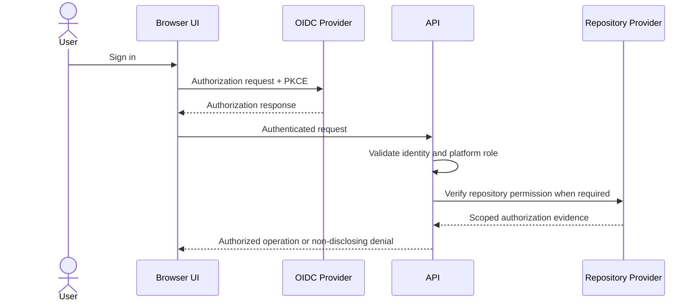

# 7. Authentication and Authorization

## 7.1 Security Objectives

The identity architecture must establish who or what is making a request, while authorization must separately determine whether that subject may act on a repository or report. Authentication alone never proves repository ownership.

The design supports human users, workload identities, public-summary access, and administrative operations without sharing credentials between these actor types.

## 7.2 Human Authentication

Human users authenticate through an external OpenID Connect provider using Authorization Code Flow with PKCE. The backend or trusted edge validates:

- Token signature against trusted issuer keys.
- Exact issuer and intended audience.
- Expiration and not-before timestamps.
- Authorization response state, nonce, and PKCE verifier.
- Required subject and tenant/organization claims.
- Authentication strength for privileged operations where policy requires it.

The platform maps the immutable external subject and issuer to an internal user identifier. Email addresses and provider usernames are attributes, not primary authorization keys.

Browser sessions use secure, HTTP-only, same-site cookies when a backend-for-frontend pattern is selected. Bearer tokens are not stored in browser local storage. State-changing requests receive CSRF protection appropriate to the session model.

## 7.3 Workload Authentication

CI/CD integrations use short-lived federated workload identities or narrowly scoped application tokens. They do not reuse human sessions or long-lived personal access tokens. Kubernetes components use distinct service accounts and workload identity to reach platform dependencies.

Every machine identity is scoped by environment, tenant, operation, and expiry. Credentials are rotated and stored in a secret manager when federation is unavailable.

## 7.4 Authorization Inputs

An authorization decision evaluates:

1. Authenticated subject or anonymous context.
2. Tenant and organizational membership.
3. Platform role and requested action.
4. Canonical repository identity and visibility.
5. Live or policy-valid repository-provider permission evidence.
6. Requested report level and data sensitivity.
7. Review ownership and delegation rules.
8. Administrative policy, suspension, quota, and retention state.

Client assertions such as `owner=true`, repository names, uploaded archives, Git history, or cached UI state are not authorization evidence.

## 7.5 Report Authorization Model

| Subject | Public Summary | Private Summary | Deep Report | Administration |
|---|:---:|:---:|:---:|:---:|
| Anonymous | Policy-permitted | No | No | No |
| Authenticated user | Policy-permitted | Provider permission required | Provider permission required | No |
| Verified repository member | Yes | Yes | Yes, within granted scope | No |
| Security role | Tenant policy | Tenant policy | Assigned tenant/repository scope | Limited |
| Platform administrator | Audited support policy | Audited support policy | Break-glass only if explicitly approved | Yes |

Deep Report authorization is enforced by the Report Service on every access, not merely when the review is created. Policy may accept recently validated evidence for a short period, but membership revocation and sensitive operations require revalidation. The decision never relies on the frontend hiding fields.

## 7.6 Ownership Verification

The repository adapter calls the provider API with an approved application or delegated user identity. It verifies the canonical repository ID and permission required by policy, such as read, triage, maintain, or admin. The minimum acceptable permission is configurable by operation and tenant.

Authorization evidence records the provider, canonical repository ID, subject mapping, permission class, checked time, policy version, and result. Access tokens and complete provider responses are not stored.

## 7.7 Role and Resource Policy

Platform roles control broad capabilities such as configuring providers, viewing operational dashboards, managing tenants, or conducting approved support. Resource-level policy controls a subject's access to a particular repository, review, or report. Both checks must succeed.

Administrative access follows least privilege and separation of duties. Sensitive support access requires explicit reason, time-bound elevation, strong authentication, and audit. A platform administrator does not automatically become a repository owner.

## 7.8 Denial and Privacy Behavior

Unauthorized access returns a response that does not confirm whether a private repository, review, or report exists. Logs record the internal denial reason without exposing it to the requester. Rate limits and anomaly detection cover repeated repository enumeration, token failures, and cross-tenant access attempts.

## 7.9 Revocation and Lifecycle

The platform supports session termination, identity disablement, provider installation removal, repository membership changes, application credential rotation, and tenant suspension. Cached authorization evidence has a bounded lifetime and is invalidated when provider webhooks or administrative events indicate revocation.

Next: [Security Architecture](08-security-architecture.md).
