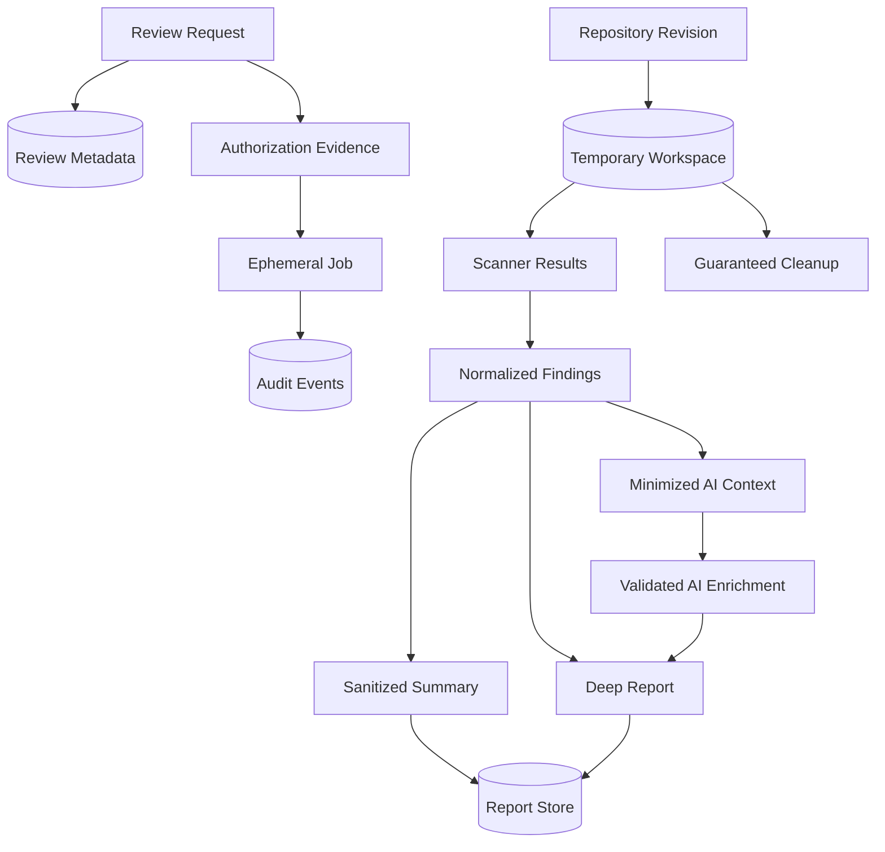

# 10. Data Flow

## 10.1 Data Lifecycle

The platform minimizes data at each stage and separates transient source processing from persistent metadata and reports.

## 10.2 Principal Data Objects

| Object | Contents | Persistence |
|---|---|---|
| Review request | Canonical repository, immutable revision, requester, policy, report level | PostgreSQL |
| Authorization evidence | Subject, provider, repository ID, permission class, decision, timestamp | PostgreSQL with bounded retention |
| Repository workspace | Checked-out source and temporary scanner artifacts | Ephemeral Job volume only |
| Raw scanner output | Tool-specific bounded result used for normalization | Temporary; optional short diagnostic retention without secrets |
| Normalized finding | Rule, severity, category, fingerprint, location, provenance | PostgreSQL and/or encrypted report object |
| AI context | Selected redacted finding evidence | In memory or temporary encrypted storage only |
| Summary Report | Aggregate and sanitized review result | Encrypted report store; policy-public view |
| Deep Report | Detailed paths, evidence, enrichment, remediation | Encrypted report store; repository-authorized |
| Audit event | Actor, action, decision, resource, policy, outcome | Append-only durable store |
| Telemetry | Operational measurements and sanitized events | Monitoring systems with separate retention |

## 10.3 Data Flow Controls

### Ingress

Requests are authenticated where required, size-limited, schema-validated, rate-limited, and canonicalized. Tokens remain in the identity middleware and are not copied into review messages.

### Repository Processing

Source enters only the scanner trust zone. It is not sent through the backend API, database, message queue, general application logs, or metrics. The workspace is unique to one review and destroyed at termination.

### Scanner Results

Raw output is treated as untrusted. Parsers enforce schema, record and field limits, valid encoding, path normalization, and secret redaction. Paths must remain relative to the repository root.

### AI Enrichment

Only policy-approved, minimized, redacted context crosses the AI provider boundary. Provider requests and responses receive size and schema limits. AI response content cannot introduce trusted links, commands, or finding identities.

### Reporting

Summary generation uses an allowlist of fields; it does not redact a Deep Report after serialization. Deep data and public data use distinct representations and object keys. Access is enforced before generating a download URL or streaming content.

## 10.4 Persistence and Retention

Review metadata and audit events use PostgreSQL transactions. Large report artifacts use object storage with encryption, versioning or object lock where required, integrity hashes, lifecycle rules, and tenant-aware access. Database records refer to opaque object identifiers rather than public URLs.

Retention is data-class and tenant-policy specific. Expiration removes report objects and sensitive finding data while retaining the minimum audit tombstone required to demonstrate deletion. Backups inherit retention and deletion requirements, with documented delayed erasure where immediate backup mutation is unsafe.

## 10.5 Data Integrity

The platform records repository provider, canonical ID, immutable commit SHA, scanner and rule-pack versions, report schema, AI policy/model provenance, generation timestamp, and artifact digest. These fields make a report attributable and detect mismatched or replaced artifacts.

State changes use transactional or idempotent patterns. A report becomes visible only after object persistence and metadata commit agree. Reconciliation repairs uncertain outcomes without duplicating a review or exposing an incomplete artifact.

## 10.6 Data Deletion

Deletion covers the ephemeral checkout, temporary scanner files, AI context, report objects, relevant database records, caches, and derived indexes. Deletion events are audited without retaining deleted content. Cleanup failure is observable and escalated rather than silently ignored.

Next: [Trust Boundaries](11-trust-boundaries.md).
