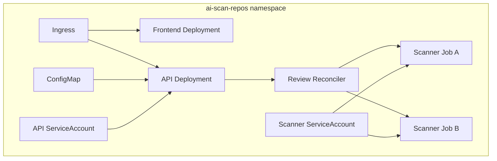

# 12. Kubernetes Architecture

## 12.1 Namespace and Workload Design

The application runs in a dedicated namespace enforcing the restricted Pod Security profile. Production may separate the control plane and scanner workloads into different namespaces to strengthen quotas, policies, node placement, and operational ownership.

## 12.2 Review Job Contract

Every review receives a unique Job with:

- A server-generated name and labels containing only opaque identifiers.
- A pinned scanner image digest.
- A non-root UID, dropped capabilities, runtime-default seccomp, and no privilege escalation.
- A read-only root filesystem plus size-limited workspace and temporary volumes.
- CPU, memory, process, storage, execution-time, and retry limits.
- No automounted Kubernetes service-account token.
- Review-scoped configuration and secret references only.
- `restartPolicy: Never`, bounded backoff, active deadline, and TTL cleanup.

Repository source resides in a Job-local `emptyDir` or stronger ephemeral volume. No persistent volume is mounted for source processing.

## 12.3 RBAC

The API or reconciler service account may create, get, watch, list, and delete Jobs in the application namespace and read only the Pod status/log resources needed for operation. It cannot create arbitrary privileged resources, manage cluster roles, read all secrets, or operate outside its namespace.

Scanner Jobs use a service account with no Kubernetes API permissions and token automount disabled. Frontend Pods also disable token automount. Deployment automation uses a separate identity from runtime services.

## 12.4 Network Policy

The namespace begins with default-deny ingress and egress. Explicit policies allow:

- Ingress controller to frontend and API ports.
- Frontend to API where server-side proxying requires it.
- API to DNS, identity provider, PostgreSQL, object storage, Kubernetes API, queue, and telemetry.
- Scanner Jobs to DNS, configured repository providers, approved scanner databases, review-scoped report upload, optional approved AI endpoint, and telemetry.

Scanner-to-scanner, scanner-to-database, public-to-scanner, and unrestricted internet traffic remain denied. Because standard NetworkPolicy is IP/port based, hostname-aware control should use an egress gateway or compatible network layer.

## 12.5 Scheduling and Capacity

Scanner workloads use a dedicated node pool where practical. Taints and tolerations keep general workloads away from the analysis pool, while node affinity prevents scanners from landing on sensitive platform nodes. Topology spread applies to long-running services; Jobs prioritize capacity isolation and quota fairness.

ResourceQuota and LimitRange bound total namespace consumption. Per-tenant concurrency limits prevent a single user from consuming all Job slots. Cluster autoscaling responds to pending approved Jobs within configured maximum capacity and cost limits.

## 12.6 Reliability and Reconciliation

The database stores desired and reported review state. A reconciler compares it with Kubernetes Job state and repairs missed events. It handles orphaned Jobs, Jobs without durable reviews, expired Jobs, stuck termination, lost Pods, and API restarts.

Kubernetes Job success alone does not mean review success. The Job must also persist a valid report result and cleanup status. Liveness probes are used only for long-running services; scanner Job progress is observed through phase metrics, heartbeats where necessary, and the active deadline.

## 12.7 Configuration and Secrets

Non-secret configuration is supplied through ConfigMaps or immutable release values and validated at startup. Secrets are synchronized or mounted from an external secret manager and are not committed to Helm values. Prefer workload identity and short-lived credentials over static Kubernetes Secrets.

## 12.8 Policy and Supply-Chain Enforcement

Admission policy requires trusted registries, signed image digests, restricted security context, resource limits, approved volume types, and forbidden host access. Images include SBOM and provenance metadata. Runtime policies alert on unexpected process, network, file, or privilege behavior without depending on runtime detection as the primary control.

## 12.9 Cleanup

The worker performs explicit workspace cleanup before exit. Pod deletion removes ephemeral volumes, and Job TTL removes finished Kubernetes objects. A scheduled controller detects stale Jobs, leaked volumes, and reconciliation mismatches. Cleanup SLOs and alerts are defined in the observability design.

Next: [Observability](13-observability.md).
